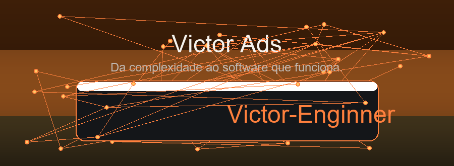

<picture>
  <source media="(prefers-reduced-motion: reduce)" srcset="assets/ember-poster.png">
  
</picture>

# Victor Ads

**Da complexidade ao software que funciona.**

## Sobre

Engenheiro de IA focado em transformar ideias complexas em software útil. Projeto o caminho do sinal → raciocínio → ação → resultado observável. Trabalho com engenharia de produto tipada, experimentos de IA em Python, design de API e automação, dados relacionais e práticas operacionais focadas em segurança.

Baseado no Brasil, construo sistemas que conectam sinais reais a resultados observáveis, com ênfase em privacidade, revisão humana e engenharia responsável.

## Projetos selecionados

## Stack

| Tecnologia | Uso |
|------------|-----|
| TypeScript | Desenvolvimento de produto e interfaces |
| JavaScript | Automação e scripts |
| Python | Experimentos de IA e prototipagem |
| React | Interfaces de usuário |
| Next.js | Framework de React |
| Tailwind CSS | Estilização |
| Node.js | Runtime e APIs |
| PostgreSQL | Banco de dados relacional |
| Supabase | Backend como serviço |
| Git | Controle de versão |
| Docker | Containerização |
| Linux | Ambiente de desenvolvimento |

## Engenharia consciente

Meu trabalho é guiado por princípios de engenharia responsável:

- **Privacidade por design**: Trato dados pessoais com responsabilidade, minimizando coleta e maximizando transparência
- **Revisão humana**: Automação é poderosa, mas decisões importantes requerem supervisão humana
- **Segurança como requisito**: Práticas de segurança são integradas desde o início, não adicionadas depois
- **Evidência sobre hype**: Prefiro resultados observáveis e medições claras a promessas exageradas

## Links

- **Perfil**: [@Victor-Enginner](https://github.com/Victor-Enginner)
- **Repositórios**: [Ver todos](https://github.com/Victor-Enginner?tab=repositories)
- **Portfólio**: [portfolio/](portfolio/)
- **Órbita Studio**: [orbita-studio](https://github.com/Victor-Enginner/orbita-studio)
- **Intelligence**: [intelligence](https://github.com/Victor-Enginner/intelligence)
- **Farol**: [farol](https://github.com/Victor-Enginner/farol)

---

*Construído como um registro de engenharia em evolução — não um currículo estático.*

