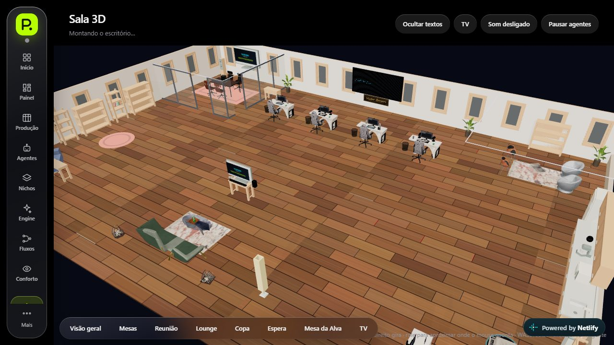
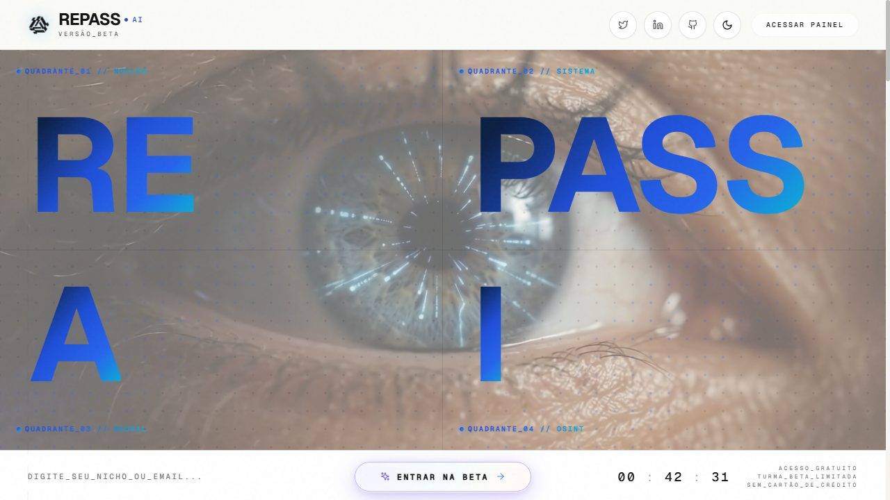
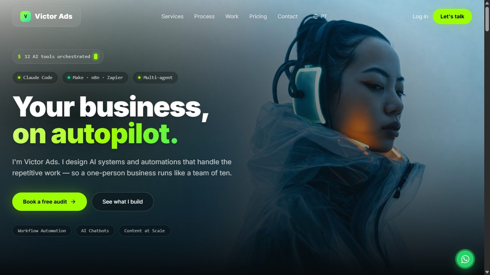
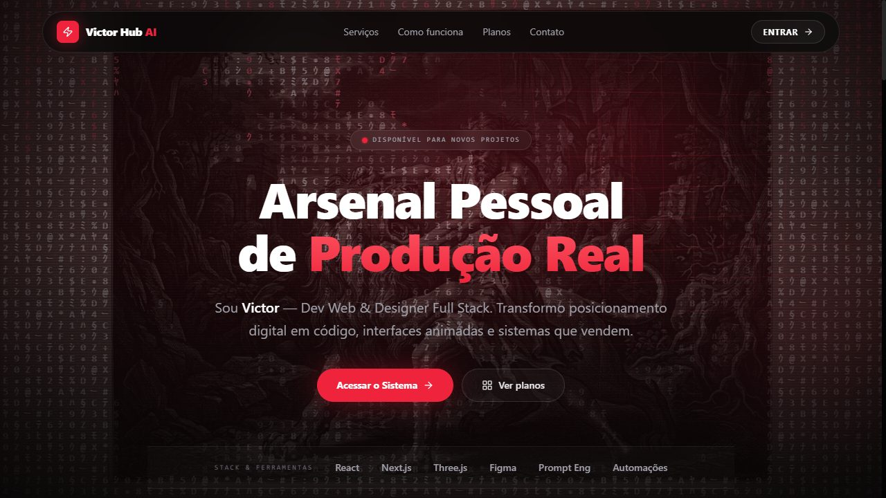
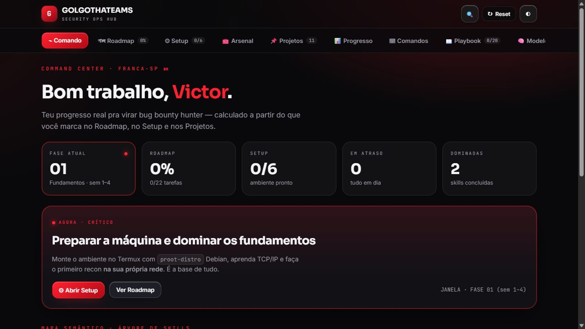
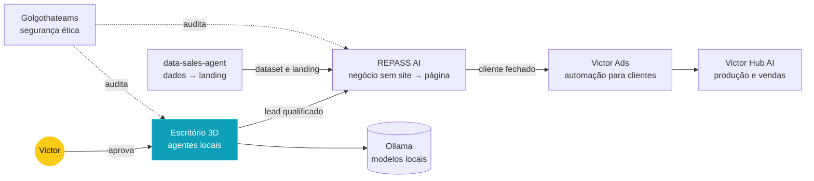
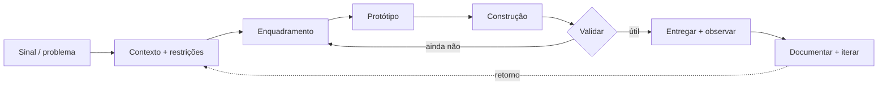
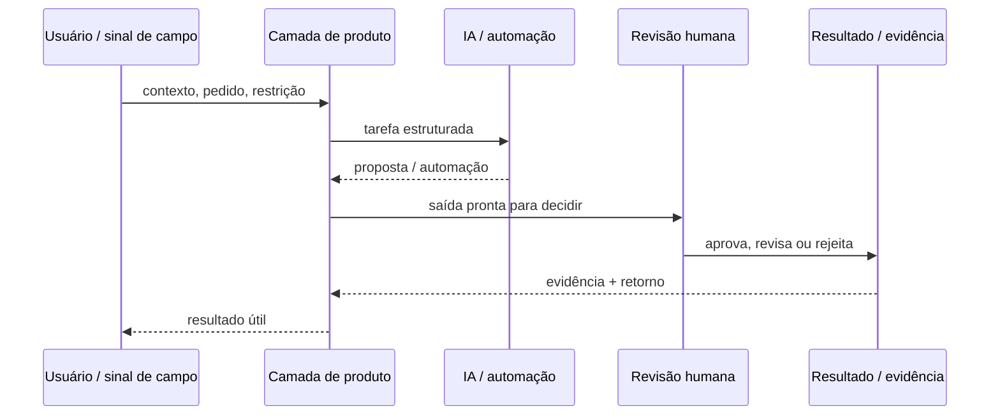

<p align="center">

</p>

<div align="center">

### ENGENHARIA DE IA · AUTOMAÇÃO · SISTEMAS DE PRODUTO · SEGURANÇA ÉTICA


<p align="center">

  <br>
  
</p>

<p align="center">
  <a href="https://ollama.com"></a>
  <a href="https://huggingface.co/Goekdeniz-Guelmez"></a>
  <a href="https://huggingface.co/Qwen"></a>
  <a href="https://huggingface.co/deepseek-ai"></a>
  <a href="https://huggingface.co/dicta-il"></a>
  <a href="https://huggingface.co/anique-1"></a>
  <a href="https://huggingface.co/yasserrmd"></a>
  <a href="https://www.anthropic.com/claude"></a>
  <a href="https://github.com/openai/codex"></a>
  <a href="https://huggingface.co/nvidia"></a>
</p>

**Da complexidade ao software que funciona.**

</div>

## `//` Sobre

Engenheiro de IA focado em transformar ideias complexas em software útil. Projeto o caminho do sinal → raciocínio → ação → resultado observável. Trabalho com engenharia de produto tipada, experimentos de IA em Python, design de API e automação, dados relacionais e práticas operacionais focadas em segurança.

Baseado no Brasil, construo sistemas que conectam sinais reais a resultados observáveis, com ênfase em privacidade, revisão humana e engenharia responsável.

## `//` Em destaque: Paraíso Artificial

**[VIRTUAL-3D-](https://github.com/Victor-Enginner/VIRTUAL-3D-)** — uma equipe de agentes de IA **locais** (Atlas, Nova, Maia, Leo e Alva) que acha empresas, audita o site, decide com modelo aberto no Ollama e prepara a abordagem, tudo visível num escritório 3D vivo. Decisões em opções fechadas com probabilidade, crença por lead com fatos versionados e revisão humana antes de qualquer envio. Node 22, sem dependências.

## `//` Projetos

<table>
<tr>
<td width="50%" valign="top"><a href="https://github.com/Victor-Enginner/VIRTUAL-3D-"></a><br><b>Escritório Virtual 3D · Paraíso Artificial</b><br><sub>Agentes de IA locais que prospectam, auditam e preparam a abordagem num escritório 3D vivo.</sub><br><a href="https://github.com/Victor-Enginner/VIRTUAL-3D-">⌨️ código</a></td>
<td width="50%" valign="top"><a href="https://repass-ai-beta.netlify.app"></a><br><b>REPASS AI</b><br><sub>Plataforma OSINT e motor agêntico de sites 3D: acha o negócio, gera o site e a abordagem.</sub><br><a href="https://repass-ai-beta.netlify.app">🌐 site</a> · <a href="https://github.com/Victor-Enginner/REPASSAI">⌨️ código</a></td>
</tr>
<tr>
<td width="50%" valign="top"><a href="https://victor-ai-enginner.vercel.app"></a><br><b>Victor Ads</b><br><sub>Sistemas de IA e automação para o negócio de uma pessoa só rodar como um time.</sub><br><a href="https://victor-ai-enginner.vercel.app">🌐 site</a> · <a href="https://github.com/Victor-Enginner/Victor-Ads">⌨️ código</a></td>
<td width="50%" valign="top"><a href="https://victor-hub-ai.vercel.app"></a><br><b>Victor Hub AI</b><br><sub>Arsenal pessoal de produção real: interfaces animadas e sistemas que vendem.</sub><br><a href="https://victor-hub-ai.vercel.app">🌐 site</a> · <a href="https://github.com/Victor-Enginner/victor-hub-ai">⌨️ código</a></td>
</tr>
<tr>
<td width="50%" valign="top"><a href="https://golgotha-project.vercel.app"></a><br><b>Golgothateams</b><br><sub>Security Ops Hub: roadmap, setup, arsenal e playbook de segurança ofensiva ética.</sub><br><a href="https://golgotha-project.vercel.app">🌐 site</a> · <a href="https://github.com/Victor-Enginner/Golgothateams">⌨️ código</a></td>
<td width="50%" valign="top"><b>data-sales-agent</b><br><sub>Pipeline local-first: dados → e-book → landing page com dashboard → relatório.</sub><br><a href="https://github.com/Victor-Enginner/data-sales-agent">⌨️ código</a></td>
</tr>
</table>

<p align="center">

</p>

## `//` Ecossistema

Como os projetos se conectam: um encontra o cliente, outro entrega o produto, todos com revisão humana no meio.



## `//` Mapa do sistema

Uma regra organiza o trabalho: toda funcionalidade conecta um sinal real a um resultado observável.



## `//` Ciclo de engenharia



## `//` Atividade

<p align="center">

</p>

<p align="center">

</p>

## `//` Princípios

```text
01. Construir pequeno, testar cedo, iterar rápido.
02. Automatizar o repetitivo; reservar o julgamento para o que importa.
03. Segurança, privacidade e IA responsável são requisitos de produto.
04. Evidência, observabilidade e falhas claras acima de hype.
05. Boa engenharia é clara, sustentável e útil para pessoas.
```

## `//` Contato

<p align="center">

</p>

- **Repositórios**: [ver todos](https://github.com/Victor-Enginner?tab=repositories)
- **Portfólio**: [Portf-lio](https://github.com/Victor-Enginner/Portf-lio) · [portfolio/](portfolio/)
- **Aberto a**: engenharia de IA · automação · sistemas de produto · segurança ética

<div align="center">

_Construído como um registro de engenharia em evolução — não um currículo estático._

</div>
